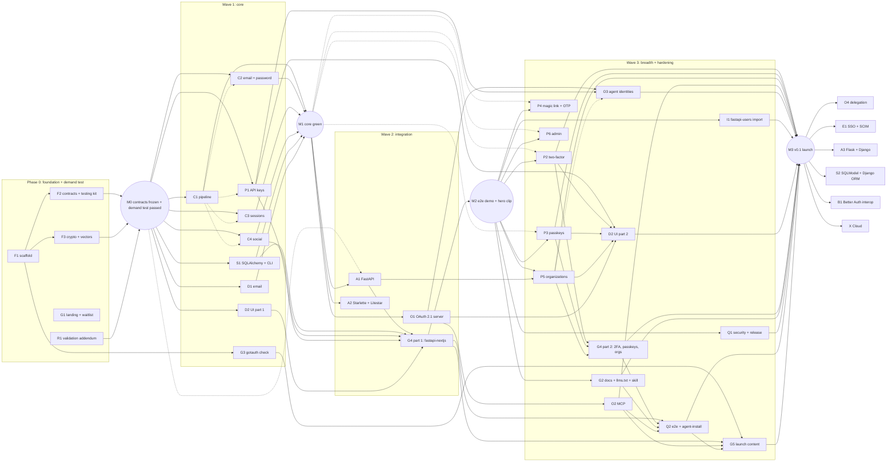

# GotAuth: parallel build plan

> **What GotAuth is:** open-source auth for Python AI backends. It covers:
> - users, sessions and social login
> - 2FA, passkeys and organizations
> - API keys and agent identities
> - a built-in OAuth 2.1 server for MCP servers
>
> All of it lives in your own database, as a library inside your FastAPI app.
>
> Strategy, positioning and marketing are in [`../build-plan.md`](../build-plan.md). This folder is the **engineering plan, split into work packages that several agents can build at the same time.**

## How parallel work is possible
1. **Contracts first.** [CONTRACTS.md](CONTRACTS.md) defines every interface, including the exact shapes of calls between plugins (section 12.5). Phase 0 turns it into code and **freezes** it (milestone M0).
2. **One agent = one work package = one folder.** Every brief has a *write scope*, and agents never edit outside it ([AGENT-RULES.md](AGENT-RULES.md)). Shared files (`pyproject.toml`, `uv.lock`, `ci.yml`, the top-level and parent `__init__.py` files, `tests/conftest.py`, `docs/plan/**`) have a single owner and are never edited by other work packages.
3. **No module imports another work package's code.** Modules import only:
   - `gotauth.contracts`, `gotauth.testing` and `gotauth.crypto`
   - the public helpers in CONTRACTS 13.2

   Plugins call each other only through `ctx.auth.api.call(...)` with the 12.5 shapes. Two agents can therefore build P1 and O3, or P5 and O3, at the same time.
4. **Nobody waits.** The testing kit `gotauth.testing` lets each work package build and test against interfaces before the real modules exist. It provides:
   - memory adapter
   - fake clock, IDs, mailer, sessions and OAuth provider
   - `make_context()` / `call_endpoint()` for unit tests from M0
   - `make_auth()` / `make_client()` for HTTP round trips once C1 merges
   - `stub_resolver()` and `stub_plugin()` to fake other plugins
   - `fresh_database_url()` for an isolated Postgres database per test session
   - adapter conformance suite and spec vectors
5. **Isolated environments.** Every worktree is its own Docker Compose project, with its own:
   - container
   - venv
   - Postgres and Redis

   No host ports are published by default, and lockfiles are only read (`uv sync --locked`). Four agents can therefore run tests at the same moment without touching each other.
6. **Conflicts show up at merge time, not at runtime.** These checks fail on the first merge that breaks something:
   - `tests/integration/test_plugin_matrix.py` (F2) builds GotAuth with every merged plugin, alone and in pairs, and fails on duplicate endpoint ids, paths, error codes, schema fields or cookie names.
   - D2's OpenAPI check fails when the UI client and the backend drift.
7. **One integrator merges** in dependency order and runs the end-to-end demo at each milestone.
8. **The plan checks itself.** [tools/verify_plan.py](tools/verify_plan.py) fails if two work packages share a write scope, if the schedule starts a work package before its hard dependencies merge, if parallel cells share files, or if a plugin calls another plugin outside CONTRACTS 12.5. Run it after every edit to `docs/plan`; CI runs it too (F1).

## Dependency graph
Solid arrows are hard dependencies (merge first). Dotted arrows mean "can start earlier against the testing kit; round-trip tests wait for this".


**Critical path:**
1. F1
2. F2 / F3
3. demand test
4. C1, then C2-C4 round trips
5. A1
6. G4 part 1
7. **M2 demo**
8. O1 -> O2
9. P2 / P3 / P5 -> G4 part 2 -> Q2
10. **M3 launch**

## Work packages
Every work package also owns its tests in `tests/<area>/**` and its news fragments in `changes/<ID>.*.md`. Only F1 edits `pyproject.toml`.

| ID | Work package | Phase | Size | Depends on | Write scope |
|---|---|---|---|---|---|
| [F1](wp/F1-scaffold.md) | Repo scaffold, per-worktree Docker env, tooling, CI | 0 | S | none | repo root (incl. `pyproject.toml`, `uv.lock`), `.github/**`, `docker/**`, `src/gotauth/__init__.py`, parent packages, skeletons |
| [F2](wp/F2-contracts-testing-kit.md) | Contracts as code, shared helpers, memory adapter, testing kit, plugin-matrix test | 0 | M | F1 | `src/gotauth/contracts`, `src/gotauth/storage/memory`, `src/gotauth/testing`, `tests/conftest.py`, `tests/integration/test_plugin_matrix.py` |
| [F3](wp/F3-crypto.md) | Crypto kit + spec vectors | 0 | M | F1, F2 types | `src/gotauth/crypto`, `spec/` |
| [G1](wp/G1-landing.md) | Landing page + waitlist | 0 | S | none | `apps/landing` |
| [R1](wp/R1-validation-addendum.md) | MCP-auth evidence + comparison draft | 0 | S | none | `docs/research`, `docs/launch/comparison.md` |
| [C1](wp/C1-pipeline.md) | Request pipeline, ASGI app, `auth.api`, origin checks, rate limits | 1 | M-L | M0 | `src/gotauth/core` |
| [C2](wp/C2-email-password.md) | Email + password flows | 1 | M | M0 | `src/gotauth/email_password` |
| [C3](wp/C3-sessions.md) | Sessions, cookies, bearer, cookie cache | 1 | M | M0 | `src/gotauth/sessions` |
| [C4](wp/C4-social.md) | Social login (OAuth2/OIDC client + providers) | 1 | M-L | M0 | `src/gotauth/social` |
| [S1](wp/S1-sqlalchemy-cli.md) | SQLAlchemy adapter, Alembic, `gotauth` CLI | 1 | L | M0 | `src/gotauth/storage/sqlalchemy`, `src/gotauth/cli` |
| [D1](wp/D1-email.md) | Email senders + templates | 1 | S-M | M0 | `src/gotauth/email` |
| [D2](wp/D2-ui-registry.md) | UI components (shadcn registry) + typed fetch client; part 2 adds plugin components and the OpenAPI check | 1, part 2 in 3 | M | M0 HTTP models; part 2 after P1, P2, P3, P5, O1 | `registry/` |
| [A1](wp/A1-fastapi.md) | FastAPI integration | 2 | M | M0 (kit) -> C1-C3 | `src/gotauth/integrations/fastapi` |
| [A2](wp/A2-starlette-litestar.md) | Starlette + Litestar integration | 2 | S-M | C1 | `src/gotauth/integrations/asgi` |
| [P1](wp/P1-api-keys.md) | API keys | 1 (late) | M | M0 (kit) -> C1 for HTTP tests | `src/gotauth/plugins/api_key` |
| [O1](wp/O1-oauth-server.md) | OAuth 2.1 authorization server + OIDC provider | 2->3 | L | C1-C3 | `src/gotauth/plugins/oauth_provider` |
| [G3](wp/G3-checkup.md) | `gotauth check` (front-door tool) | 1 (late) | M | F1 | `src/gotauth/checkup` |
| [G4](wp/G4-examples.md) | Examples (+ hero-clip app) | 2->3 | M | A1, S1, C4, P1, D2; part 2 after P2, P3, P5 | `examples/fastapi-nextjs`, `examples/litestar-htmx`, `examples/README.md` |
| [P2](wp/P2-two-factor.md) | Two-factor auth | 3 | M | C2, C3 | `src/gotauth/plugins/two_factor` |
| [P3](wp/P3-passkeys.md) | Passkeys (WebAuthn) | 3 | M | C3 | `src/gotauth/plugins/passkey` |
| [P4](wp/P4-magic-link-otp.md) | Magic link + email OTP | 3 | S-M | C3, D1 | `src/gotauth/plugins/magic_link` |
| [P5](wp/P5-organizations.md) | Organizations + access control | 3 | L | C3, A1 | `src/gotauth/plugins/organization` |
| [P6](wp/P6-admin.md) | Admin | 3 | S-M | C3 | `src/gotauth/plugins/admin` |
| [O2](wp/O2-mcp.md) | MCP integration (FastMCP + MCP SDK) + MCP example | 3 | M | O1 | `src/gotauth/integrations/mcp`, `examples/fastmcp-server` |
| [O3](wp/O3-agents.md) | Agent identities v1 | 3 | M | P1, O1 | `src/gotauth/plugins/agent` |
| [I1](wp/I1-import-fastapi-users.md) | `gotauth import fastapi-users` | 3 | M | S1, F3 | `src/gotauth/importers/fastapi_users` |
| [G2](wp/G2-docs-agent-readiness.md) | Docs, llms.txt, skill, Context7 | 3 | L | adapters | `apps/docs`, `skills/`, `.github/workflows/docs.yml` |
| [Q1](wp/Q1-security-release.md) | Security hardening + release pipeline | 3 (reviews from 1) | L | core, O1, S1 | `tests/security`, `docs/security`, `SECURITY.md`, `.github/workflows/release.yml` and `security.yml`, `docs/requests/Q1-*.md` |
| [Q2](wp/Q2-e2e-agent-install.md) | E2E + agent-install test | 3 | M | G4, G2 | `tests/e2e`, `scripts/agent-install-test`, `docs/launch/agent-baseline.md` |
| [G5](wp/G5-launch-content.md) | Launch content drafts | 3 | M | research, G3, G4, O2 | `docs/launch/**` except `comparison.md` (R1) and `agent-baseline.md` (Q2) |
| [O4](wp/O4-delegation.md) | Delegation chains (RFC 8693) | 4 | L | O3 | `src/gotauth/plugins/agent/delegation` |
| [E1](wp/E1-sso-scim.md) | Enterprise SSO (OIDC + SAML) + SCIM | 4 | XL | P5 | `src/gotauth/plugins/sso`, `src/gotauth/plugins/scim` |
| [A3](wp/A3-flask-django.md) | Flask + Django integrations | 4 | M each | C1 | `src/gotauth/integrations/flask`, `.../django` |
| [S2](wp/S2-sqlmodel-django-orm.md) | SQLModel models + Django ORM adapter | 4 | M each | S1 | `src/gotauth/storage/sqlmodel`, `.../django` |
| [B1](wp/B1-better-auth-interop.md) | Better Auth interop | 4 | M | C3, O1 | `src/gotauth/interop/better_auth` |
| [X](wp/X-cloud.md) | GotAuth Cloud (-> X1-X3) | 5 | XL | demand gate | `cloud/` |

**Sizes:**

| Size | Agent-days |
|---|---|
| S | <= 1 |
| M | 1-2 |
| L | 3-5 |
| XL | split before starting |

## Milestones (integrator checklist)
| Milestone | Done when | You (human) then... |
|---|---|---|
| **M0: Contracts frozen** | F1-F3 merged; `./dev.sh uv run poe check` green; memory adapter passes conformance; spec vectors pass; **the demand test passed** (see build plan) | Start Wave 1. Post the "AI agents still write Python auth with passlib" thread |
| **M1: Core green** | C1-C4, S1, D1 merged; adapter conformance green on memory, SQLite and Postgres | Technical thread: hashed session tokens, no account enumeration |
| **M2: E2E demo** | `examples/fastapi-nextjs`: sign up -> verify email (console) -> GitHub login -> session cookie -> create API key -> `curl` a protected route with the key -> revoke -> 401 | **Record the hero clip**; publish `uvx gotauth check` |
| **MCP demo** | O2 merged; `examples/fastmcp-server`: Claude connects -> GotAuth passkey login + consent -> tools work -> revoke in the app -> 401 | Record the MCP clip; open the FastMCP docs PR |
| **M3: v0.1 launch** | Wave 3 merged except anything cut; agent-install test passes 3/3; OpenID conformance run for O1; release pipeline publishes with attestations | Launch week (build plan checklist); post-launch test 3 weeks later |
| **M4+** | Only after the post-launch test passes | Pick from Phase 4 by demand |

## Suggested schedule with 4 agents at a time
You are the only reviewer, so **review is the bottleneck, not the agents**. Keep at most about 4 agents running, plus yourself.

Every cell starts only after its hard dependencies have merged. A cell marked "(kit)" starts against the testing kit and adds round-trip tests after the named work package merges.

| Week | Slot 1 | Slot 2 | Slot 3 | Slot 4 |
|---|---|---|---|---|
| 1 (Phase 0) | F1 -> F2 | G1 | (after F1) F3 | R1 |
| 2 (Wave 1, after the demand test passes) | C1 | C2 (kit; round trips after C1) | C4 (kit; round trips after C1) | S1 |
| 3 | C3 | D1 -> P1 (kit; HTTP tests after C1) | D2 part 1 | S1 (continued) -> G3 |
| 4 (Wave 2) | A1 -> G4 part 1 (**M2**) | O1 | A2 | Q1 (threat model, checklist, first tests) |
| 5 (Wave 3) | P2 | O1 (continued) -> O2 | P3 | P5 |
| 6 | O3 | I1 | G2 | D2 part 2 |
| 7 | G4 part 2 -> Q2 | G5 | Q1 (finish) | P4 / P6 (only if on time) -> **M3** |

**Why this order is safe in parallel:**
- No two cells in the same row share a write scope.
- P1 and G3 move up into week 3 because they need only the testing kit and F1. That frees week 4 for O1, the longest work package.
- P5 waits for A1 (`require(permission=...)`), and O3 waits for P1 and O1. D2 part 2 and G4 part 2 wait for the plugins they show.
- Q2's browser tests for 2FA, passkeys and orgs run after G4 part 2, in the same slot.

That's about 7 weeks to v0.1 if you review steadily. **If you're part-time, keep 2 slots instead of 4**; that's about 12 weeks. Run the same rows in order, two cells at a time.

## How to run an agent on a work package
1. **Create a worktree** (after F1 has created the repo), and install inside Docker:
   ```bash
   git worktree add ../gotauth-c3 -b wp/c3-sessions
   cd ../gotauth-c3 && ./dev.sh uv sync --locked --all-extras
   ```
2. **Start a Claude Code session** in that folder, either one terminal per slot or a separate session in the desktop app.
3. **Give it this prompt**, changing the ID:
   > You are implementing work package **C3** for GotAuth. Read `AGENTS.md`, `docs/plan/CONTRACTS.md` and `docs/plan/wp/C3-sessions.md`. Work only inside the write scope. Use `gotauth.testing` instead of waiting for other work packages. Stop when every acceptance test passes and `./dev.sh uv run poe check` is green. Then summarize what you built, what you stubbed, and any request or CCR files you created.
4. **Review** the PR: check the acceptance tests and the write scope. Then merge, in dependency order.

You can also ask Claude to start a whole wave as parallel agents, each in its own isolated worktree. Say "run Wave 1" once M0 is merged.

## Skills per work package
Agents load these skills with the Skill tool before starting, and list them in the PR description.

| Work packages | Skills |
|---|---|
| G1 landing, G4 example frontends | `modern-web-guidance:modern-web-guidance` (mandatory for any HTML, CSS or client JS), `design:ux-copy`, `design:accessibility-review` |
| D2 UI registry | `modern-web-guidance:modern-web-guidance`, `design:design-system`, `design:ux-copy`, `design:accessibility-review` |
| G2 docs site | `modern-web-guidance:modern-web-guidance`, `design:accessibility-review` |
| O1 OAuth server, O2 MCP, Q2 agent-install test | `claude-api` (MCP, Claude Code and Agent SDK details); Q2 also uses the `run` skill to drive the example apps |
| Integrator, on every branch before merging | `code-review` |
| Integrator, on security-critical branches (C1-C4, P1-P3, P6, O1-O3, Q1) | `security-review` |
| Integrator, at M2 and the MCP demo | `run`, to see the example apps working |

## Integrator routine (after every merge)
1. `./dev.sh uv run poe check` is green on `main`.
   - Before removing a merged worktree, stop and delete its Docker project so idle databases, volumes and images do not pile up. In the worktree run `docker compose -p <folder name> down --volumes --rmi local`, then run `git worktree remove`. The shared uv and pnpm caches are external volumes and are kept.
2. After M2: run the `fastapi-nextjs` scenario. After O2: run the `fastmcp-server` scenario.
3. Update the **Status** table below.
4. Handle any new `docs/requests/*` or `docs/ccr/*` files: accept, reject or schedule them. Give each accepted CCR the next number (`docs/ccr/<NNN>-<topic>.md`) and bump `CONTRACT_VERSION`.
5. Check that `tests/integration/test_plugin_matrix.py` still passes with the newly merged plugin. A failure means two plugins collide; fix it before the next merge.
6. After changing anything in `docs/plan` (status table excepted), run `python docs/plan/tools/verify_plan.py`.
7. **Monthly:** run the competitor watch from the build plan.

## Cut list (if behind schedule, cut in this order)
1. Docs MCP server (G2) and the Apple provider with its POST callback (C4)
2. Litestar (A2; keep Starlette)
3. P6 admin
4. P4 magic link and email OTP
5. Teams inside organizations (P5)
6. MySQL support (S1)

**Never cut:**
- fail-closed defaults
- tokens hashed at rest
- rate limits on by default
- origin checks
- PKCE + CIMD in O1
- the O2 MCP example
- the agent-install test
- `llms.txt`
- `gotauth check`
- the hero clip

## Status
| ID | Status | PR | Notes |
|---|---|---|---|
| F1, F2, F3, G1, R1 | not started | | Phase 0 |
| C1, C2, C3, C4, S1, D1, D2 | not started | | Waits for M0 and the demand test |
| A1, A2, P1, O1, G3, G4 | not started | | |
| P2, P3, P4, P5, P6, O2, O3, I1, G2, Q1, Q2, G5 | not started | | |
| O4, E1, A3, S2, B1, X | not started | | Only after the post-launch test |
