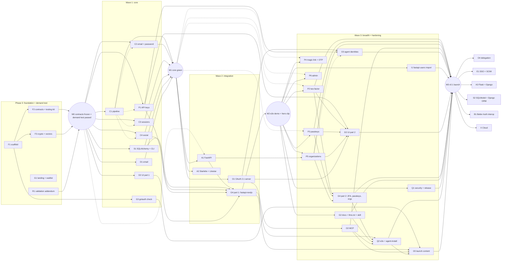

# GotAuth: parallel build plan

> **What GotAuth is:** open-source auth for Python AI backends. It covers:
> - users, sessions and social login
> - 2FA, passkeys and organizations
> - API keys and agent identities
> - a built-in OAuth 2.1 server for MCP servers
>
> All of it lives in your own database, as a library inside your FastAPI app.
>
> The pitch, positioning and roadmap are in [`../build-plan.md`](../build-plan.md). This folder is the **engineering plan, split into work packages that several agents can build at the same time.**

## How parallel work is possible
1. **Contracts first.** [CONTRACTS.md](CONTRACTS.md) defines every interface, including the exact shapes of calls between plugins (section 12.5). Phase 0 turns it into code and **freezes** it (milestone M0).
2. **One agent = one work package = one folder.** Every brief has a *write scope*, and agents never edit outside it ([AGENT-RULES.md](AGENT-RULES.md)). Shared files (`pyproject.toml`, `uv.lock`, `ci.yml`, the top-level and parent `__init__.py` files, `tests/conftest.py`, `docs/plan/**`) have a single owner and are never edited by other work packages.
3. **No module imports another work package's code.** Modules import only:
   - `gotauth.contracts`, `gotauth.testing` and `gotauth.crypto`
   - the public helpers in CONTRACTS 13.2

   Plugins call each other only through `ctx.auth.api.call(...)` with the 12.5 shapes. Two agents can therefore build P1 and O3, or P5 and O3, at the same time.
4. **Nobody waits.** The testing kit `gotauth.testing` lets each work package build and test against interfaces before the real modules exist. It provides:
   - memory adapter
   - fake clock, IDs, mailer, sessions and OAuth provider
   - `make_context()` / `call_endpoint()` for unit tests from M0
   - `make_auth()` / `make_client()` for HTTP round trips once C1 merges
   - `stub_resolver()` and `stub_plugin()` to fake other plugins
   - `fresh_database_url()` for an isolated Postgres database per test session
   - adapter conformance suite and spec vectors
5. **Isolated environments.** Every worktree is its own Docker Compose project, with its own:
   - container
   - venv
   - Postgres and Redis

   No host ports are published by default, and lockfiles are only read (`uv sync --locked`). Four agents can therefore run tests at the same moment without touching each other.
6. **Conflicts show up at merge time, not at runtime.** These checks fail on the first merge that breaks something:
   - `tests/integration/test_plugin_matrix.py` (F2) builds GotAuth with every merged plugin, alone and in pairs, and fails on duplicate endpoint ids, paths, error codes, schema fields or cookie names.
   - D2's OpenAPI check fails when the UI client and the backend drift.
7. **One integrator merges** in dependency order and runs the end-to-end demo at each milestone.
8. **The plan checks itself.** [tools/verify_plan.py](tools/verify_plan.py) fails if two work packages share a write scope, if the schedule starts a work package before its hard dependencies merge, if parallel cells share files, or if a plugin calls another plugin outside CONTRACTS 12.5. Run it after every edit to `docs/plan`; CI runs it too (F1).

## Dependency graph
Solid arrows are hard dependencies (merge first). Dotted arrows mean "can start earlier against the testing kit; round-trip tests wait for this".


**Critical path:**
1. F1
2. F2 / F3
3. demand test
4. C1, then C2-C4 round trips
5. A1
6. G4 part 1
7. **M2 demo**
8. O1 -> O2
9. P2 / P3 / P5 -> G4 part 2 -> Q2
10. **M3 launch**

## Work packages
Every work package also owns its tests in `tests/<area>/**` and its news fragments in `changes/<ID>.*.md`. Only F1 edits `pyproject.toml`.

| ID | Work package | Phase | Size | Depends on | Write scope |
|---|---|---|---|---|---|
| [F1](wp/F1-scaffold.md) | Repo scaffold, per-worktree Docker env, tooling, CI | 0 | S | none | repo root (incl. `pyproject.toml`, `uv.lock`), `.github/**`, `docker/**`, `src/gotauth/__init__.py`, parent packages, skeletons |
| [F2](wp/F2-contracts-testing-kit.md) | Contracts as code, shared helpers, memory adapter, testing kit, plugin-matrix test | 0 | M | F1 | `src/gotauth/contracts`, `src/gotauth/storage/memory`, `src/gotauth/testing`, `tests/conftest.py`, `tests/integration/test_plugin_matrix.py` |
| [F3](wp/F3-crypto.md) | Crypto kit + spec vectors | 0 | M | F1, F2 types | `src/gotauth/crypto`, `spec/` |
| [G1](wp/G1-landing.md) | Landing page + waitlist | 0 | S | none | `apps/landing` |
| [R1](wp/R1-validation-addendum.md) | MCP-auth evidence + comparison draft | 0 | S | none | `docs/research`, `docs/launch/comparison.md` |
| [C1](wp/C1-pipeline.md) | Request pipeline, ASGI app, `auth.api`, origin checks, rate limits | 1 | M-L | M0 | `src/gotauth/core` |
| [C2](wp/C2-email-password.md) | Email + password flows | 1 | M | M0 | `src/gotauth/email_password` |
| [C3](wp/C3-sessions.md) | Sessions, cookies, bearer, cookie cache | 1 | M | M0 | `src/gotauth/sessions` |
| [C4](wp/C4-social.md) | Social login (OAuth2/OIDC client + providers) | 1 | M-L | M0 | `src/gotauth/social` |
| [S1](wp/S1-sqlalchemy-cli.md) | SQLAlchemy adapter, Alembic, `gotauth` CLI | 1 | L | M0 | `src/gotauth/storage/sqlalchemy`, `src/gotauth/cli` |
| [D1](wp/D1-email.md) | Email senders + templates | 1 | S-M | M0 | `src/gotauth/email` |
| [D2](wp/D2-ui-registry.md) | UI components (shadcn registry) + typed fetch client; part 2 adds plugin components and the OpenAPI check | 1, part 2 in 3 | M | M0 HTTP models; part 2 after P1, P2, P3, P5, O1 | `registry/` |
| [A1](wp/A1-fastapi.md) | FastAPI integration | 2 | M | M0 (kit) -> C1-C3 | `src/gotauth/integrations/fastapi` |
| [A2](wp/A2-starlette-litestar.md) | Starlette + Litestar integration | 2 | S-M | C1 | `src/gotauth/integrations/asgi` |
| [P1](wp/P1-api-keys.md) | API keys | 1 (late) | M | M0 (kit) -> C1 for HTTP tests | `src/gotauth/plugins/api_key` |
| [O1](wp/O1-oauth-server.md) | OAuth 2.1 authorization server + OIDC provider | 2->3 | L | C1-C3 | `src/gotauth/plugins/oauth_provider` |
| [G3](wp/G3-checkup.md) | `gotauth check` (front-door tool) | 1 (late) | M | F1 | `src/gotauth/checkup` |
| [G4](wp/G4-examples.md) | Examples (+ hero-clip app) | 2->3 | M | A1, S1, C4, P1, D2; part 2 after P2, P3, P5 | `examples/fastapi-nextjs`, `examples/litestar-htmx`, `examples/README.md` |
| [P2](wp/P2-two-factor.md) | Two-factor auth | 3 | M | C2, C3 | `src/gotauth/plugins/two_factor` |
| [P3](wp/P3-passkeys.md) | Passkeys (WebAuthn) | 3 | M | C3 | `src/gotauth/plugins/passkey` |
| [P4](wp/P4-magic-link-otp.md) | Magic link + email OTP | 3 | S-M | C3, D1 | `src/gotauth/plugins/magic_link` |
| [P5](wp/P5-organizations.md) | Organizations + access control | 3 | L | C3, A1 | `src/gotauth/plugins/organization` |
| [P6](wp/P6-admin.md) | Admin | 3 | S-M | C3 | `src/gotauth/plugins/admin` |
| [O2](wp/O2-mcp.md) | MCP integration (FastMCP + MCP SDK) + MCP example | 3 | M | O1 | `src/gotauth/integrations/mcp`, `examples/fastmcp-server` |
| [O3](wp/O3-agents.md) | Agent identities v1 | 3 | M | P1, O1 | `src/gotauth/plugins/agent` |
| [I1](wp/I1-import-fastapi-users.md) | `gotauth import fastapi-users` | 3 | M | S1, F3 | `src/gotauth/importers/fastapi_users` |
| [G2](wp/G2-docs-agent-readiness.md) | Docs, llms.txt, skill, Context7 | 3 | L | adapters | `apps/docs`, `skills/`, `.github/workflows/docs.yml` |
| [Q1](wp/Q1-security-release.md) | Security hardening + release pipeline | 3 (reviews from 1) | L | core, O1, S1 | `tests/security`, `docs/security`, `SECURITY.md`, `.github/workflows/release.yml` and `security.yml`, `docs/requests/Q1-*.md` |
| [Q2](wp/Q2-e2e-agent-install.md) | E2E + agent-install test | 3 | M | G4, G2 | `tests/e2e`, `scripts/agent-install-test`, `docs/launch/agent-baseline.md` |
| [G5](wp/G5-launch-content.md) | Launch content drafts | 3 | M | research, G3, G4, O2 | `docs/launch/**` except `comparison.md` (R1) and `agent-baseline.md` (Q2) |
| [O4](wp/O4-delegation.md) | Delegation chains (RFC 8693) | 4 | L | O3 | `src/gotauth/plugins/agent/delegation` |
| [E1](wp/E1-sso-scim.md) | Enterprise SSO (OIDC + SAML) + SCIM | 4 | XL | P5 | `src/gotauth/plugins/sso`, `src/gotauth/plugins/scim` |
| [A3](wp/A3-flask-django.md) | Flask + Django integrations | 4 | M each | C1 | `src/gotauth/integrations/flask`, `.../django` |
| [S2](wp/S2-sqlmodel-django-orm.md) | SQLModel models + Django ORM adapter | 4 | M each | S1 | `src/gotauth/storage/sqlmodel`, `.../django` |
| [B1](wp/B1-better-auth-interop.md) | Better Auth interop | 4 | M | C3, O1 | `src/gotauth/interop/better_auth` |
| [X](wp/X-cloud.md) | GotAuth Cloud (-> X1-X3) | 5 | XL | demand gate | `cloud/` |

**Sizes:**

| Size | Agent-days |
|---|---|
| S | <= 1 |
| M | 1-2 |
| L | 3-5 |
| XL | split before starting |

## Milestones (integrator checklist)
| Milestone | Done when | You (human) then... |
|---|---|---|
| **M0: Contracts frozen** | F1-F3 merged; `./dev.sh uv run poe check` green; memory adapter passes conformance; spec vectors pass; **the demand test passed** (see build plan) | Start Wave 1. Post the "AI agents still write Python auth with passlib" thread |
| **M1: Core green** | C1-C4, S1, D1 merged; adapter conformance green on memory, SQLite and Postgres | Technical thread: hashed session tokens, no account enumeration |
| **M2: E2E demo** | `examples/fastapi-nextjs`: sign up -> verify email (console) -> GitHub login -> session cookie -> create API key -> `curl` a protected route with the key -> revoke -> 401 | **Record the hero clip**; publish `uvx gotauth check` |
| **MCP demo** | O2 merged; `examples/fastmcp-server`: Claude connects -> GotAuth passkey login + consent -> tools work -> revoke in the app -> 401 | Record the MCP clip; open the FastMCP docs PR |
| **M3: v0.1 launch** | Wave 3 merged except anything cut; agent-install test passes 3/3; OpenID conformance run for O1; release pipeline publishes with attestations | Launch week (build plan checklist); post-launch test 3 weeks later |
| **M4+** | Only after the post-launch test passes | Pick from Phase 4 by demand |

## Suggested schedule with 4 agents at a time
You are the only reviewer, so **review is the bottleneck, not the agents**. Keep at most about 4 agents running, plus yourself.

Every cell starts only after its hard dependencies have merged. A cell marked "(kit)" starts against the testing kit and adds round-trip tests after the named work package merges.

| Week | Slot 1 | Slot 2 | Slot 3 | Slot 4 |
|---|---|---|---|---|
| 1 (Phase 0) | F1 -> F2 | G1 | (after F1) F3 | R1 |
| 2 (Wave 1, after the demand test passes) | C1 | C2 (kit; round trips after C1) | C4 (kit; round trips after C1) | S1 |
| 3 | C3 | D1 -> P1 (kit; HTTP tests after C1) | D2 part 1 | S1 (continued) -> G3 |
| 4 (Wave 2) | A1 -> G4 part 1 (**M2**) | O1 | A2 | Q1 (threat model, checklist, first tests) |
| 5 (Wave 3) | P2 | O1 (continued) -> O2 | P3 | P5 |
| 6 | O3 | I1 | G2 | D2 part 2 |
| 7 | G4 part 2 -> Q2 | G5 | Q1 (finish) | P4 / P6 (only if on time) -> **M3** |

**Why this order is safe in parallel:**
- No two cells in the same row share a write scope.
- P1 and G3 move up into week 3 because they need only the testing kit and F1. That frees week 4 for O1, the longest work package.
- P5 waits for A1 (`require(permission=...)`), and O3 waits for P1 and O1. D2 part 2 and G4 part 2 wait for the plugins they show.
- Q2's browser tests for 2FA, passkeys and orgs run after G4 part 2, in the same slot.

That's about 7 weeks to v0.1 if you review steadily. **If you're part-time, keep 2 slots instead of 4**; that's about 12 weeks. Run the same rows in order, two cells at a time.

## How to run an agent on a work package
1. **Create a worktree** (after F1 has created the repo), and install inside Docker:
   ```bash
   git worktree add ../gotauth-c3 -b wp/c3-sessions
   cd ../gotauth-c3 && ./dev.sh uv sync --locked --all-extras
   ```
2. **Start a Claude Code session** in that folder, either one terminal per slot or a separate session in the desktop app.
3. **Give it this prompt**, changing the ID:
   > You are implementing work package **C3** for GotAuth. Read `AGENTS.md`, `docs/plan/CONTRACTS.md` and `docs/plan/wp/C3-sessions.md`. Work only inside the write scope. Use `gotauth.testing` instead of waiting for other work packages. Stop when every acceptance test passes and `./dev.sh uv run poe check` is green. Then summarize what you built, what you stubbed, and any request or CCR files you created.
4. **Review** the PR: check the acceptance tests and the write scope. Then merge, in dependency order.

You can also ask Claude to start a whole wave as parallel agents, each in its own isolated worktree. Say "run Wave 1" once M0 is merged.

## Skills per work package
Agents load these skills with the Skill tool before starting, and list them in the PR description.

| Work packages | Skills |
|---|---|
| G1 landing, G4 example frontends | `modern-web-guidance:modern-web-guidance` (mandatory for any HTML, CSS or client JS), `design:ux-copy`, `design:accessibility-review` |
| D2 UI registry | `modern-web-guidance:modern-web-guidance`, `design:design-system`, `design:ux-copy`, `design:accessibility-review` |
| G2 docs site | `modern-web-guidance:modern-web-guidance`, `design:accessibility-review` |
| O1 OAuth server, O2 MCP, Q2 agent-install test | `claude-api` (MCP, Claude Code and Agent SDK details); Q2 also uses the `run` skill to drive the example apps |
| Integrator, on every branch before merging | `code-review` |
| Integrator, on security-critical branches (C1-C4, P1-P3, P6, O1-O3, Q1) | `security-review` |
| Integrator, at M2 and the MCP demo | `run`, to see the example apps working |

## Integrator routine (after every merge)
1. `./dev.sh uv run poe check` is green on `main`.
   - Before removing a merged worktree, stop and delete its Docker project so idle databases, volumes and images do not pile up. In the worktree run `docker compose -p <folder name> down --volumes --rmi local`, then run `git worktree remove`. The shared uv and pnpm caches are external volumes and are kept.
2. After M2: run the `fastapi-nextjs` scenario. After O2: run the `fastmcp-server` scenario.
3. Update the **Status** table below.
4. Handle any new `docs/requests/*` or `docs/ccr/*` files: accept, reject or schedule them. Give each accepted CCR the next number (`docs/ccr/<NNN>-<topic>.md`) and bump `CONTRACT_VERSION`.
5. Check that `tests/integration/test_plugin_matrix.py` still passes with the newly merged plugin. A failure means two plugins collide; fix it before the next merge.
6. After changing anything in `docs/plan` (status table excepted), run `python docs/plan/tools/verify_plan.py`.
7. **Monthly:** run the competitor watch from the build plan.

## Cut list (if behind schedule, cut in this order)
1. Docs MCP server (G2) and the Apple provider with its POST callback (C4)
2. Litestar (A2; keep Starlette)
3. P6 admin
4. P4 magic link and email OTP
5. Teams inside organizations (P5)
6. MySQL support (S1)

**Never cut:**
- fail-closed defaults
- tokens hashed at rest
- rate limits on by default
- origin checks
- PKCE + CIMD in O1
- the O2 MCP example
- the agent-install test
- `llms.txt`
- `gotauth check`
- the hero clip

## Status
**M1 reached on 2026-10-07:** C1-C4, S1 and D1 merged, plus P1 and D2 part 1; adapter conformance green on memory, SQLite and Postgres. Next: Wave 2 (A1, A2, O1, Q1).

**M0 reached on 2026-10-04:** F1, F2 and F3 merged and `poe check` is green on `main`. The contracts are frozen; changes now go through `docs/ccr/`. The demand test (build plan) is the owner's call.

| ID | Status | Merge | Notes |
|---|---|---|---|
| F1 | done | `8b6324d` | Docker dev env per worktree, CI incl. Node projects, text and AGENTS.md checks. `code-review`: 8 findings, all fixed |
| R1 | done | `0e096fb`, requests applied in `94c8418` | G9 passes (thin). MCP authorization 2026-07-28 rules applied |
| G1 | done | `e450c1e` | Landing page; Lighthouse 100/100/100/100. `code-review`: 5 findings, all fixed |
| G3 | done | `0f3bd73` | `gotauth check`: 13 rules, text, JSON and SARIF 2.1.0 |
| F3 | done | `5cbccdd` | Crypto kit and spec vectors (Node cross-check). Surrogate bug in `unsign` found and fixed during F2 |
| F2 | done | `a5b3f2b` | Contracts as code (tested against CONTRACTS.md), memory adapter, testing kit. `code-review`: 3 findings, all fixed |
| C1 | done | `48c763b` | Request pipeline, rate limiter, `auth.api`, ASGI app. `code-review`: 6 findings, all fixed; `security-review`: none |
| C3 | done | `c09f485` | Sessions, cookie cache, memory and Redis secondary storage. `code-review`: 3 findings, all fixed; `security-review`: none |
| C2 | done | `b0ecd29` | Email and password flows, enumeration rules, pre-hijacking guard. `code-review`: 3 findings, all fixed; `security-review`: one sub-threshold note (pre-hijacking), fixed. CCR 001 (UniqueViolation keeps the transaction usable) accepted, implemented by S1 |
| C4 | done | `16ab347` | Social login: 7 providers, `social/oidc.py`, PKCE, browser-bound state. `code-review`: 3 findings, all fixed; `security-review`: one sub-threshold note, fixed in C2 (verification links only for password users) |
| S1 | done | `90eaaab` | SQLAlchemy adapter (conformance on Postgres, SQLite file and memory), `gotauth` CLI (`init`, `migrate`, `generate`, `secret`). Accepted CCR 001, `CONTRACT_VERSION` 1. `code-review`: 7 findings, 6 fixed, 1 documented (root adapter inside a transaction) |
| D1 | done | `b9c9385` | Email service: default templates for all eight kinds, console (stderr, localhost only), SMTP and Resend senders, background delivery off localhost. `code-review`: 2 findings, both fixed |
| P1 | done | `a8c3bff` | API keys: create/list/update/delete, server-only issue/verify/revoke, `gak_` resolver, per-key rate limits. Accepted CCR 002 (`auth.secondary_storage`), `CONTRACT_VERSION` 2. `code-review`: 4 findings, all fixed; `security-review`: none (note for P6: revocation that the owner cannot undo) |
| D2 part 1 | done | `f14b106` | shadcn registry: typed client (core + API keys), `useSession`, WebAuthn helpers, SignInForm, SignUpForm, SocialButtons, UserButton, SessionList, ApiKeyManager; Next.js 16 and Vite 8 fixtures build. `code-review`: 8 findings, all fixed. Part 2 waits for P2, P3, P5, O1 |
| A1 | done | `bbcd86b` | FastAPI integration: router with full OpenAPI (custom APIRoute, validation stays 400), `current_user`/`optional_user`/`current_session`/`current_principal`/`api_key_principal`, `require()`, exception handlers, `check_app`. `code-review`: 4 findings, all fixed |
| A2 | done | `290f108` | Starlette backend, middleware, `requires_scopes`, lifespan; Litestar plugin with mounts at `base_path` and `/.well-known`, dependencies, guards, refresh cookies and shutdown drain. `code-review`: 5 findings, all fixed |
| O1 | done | `91b4b5c` | OAuth 2.1 server + OIDC provider: code + PKCE, consent (page, own page, JSON), refresh rotation, client credentials, ES256 tokens and key rotation, introspection, revocation, userinfo, discovery, CIMD behind an SSRF guard, RFC 8707 resources, optional DCR; conformance app for Q1. Accepted CCR 003 (`auth_time`), `CONTRACT_VERSION` 3. `code-review`: 8 findings, 7 fixed, 1 documented; `security-review`: none |
| Q1 | done (2 steps pending) | `a185452` | `tests/security` (enumeration and timing, origin/CSRF, redirects, fixation, cookie flags, raw-token scan on SQLite, rate limits, replay, OAuth attacks, fuzzing of every endpoint), threat model, ASVS 5.0 L2 mapping, review checklist, SECURITY.md, `security.yml`, `release.yml`. Findings filed as requests: `Q1-C2-timing`, `Q1-C2-asvs-gaps`, `Q1-C3-asvs-gaps`, `Q1-F3-scrypt-cost`, `Q1-O1-asvs-gaps`. Pending: the OpenID conformance run (needs a public URL and the O1 sign-in page) and the TestPyPI dry run (needs the maintainer's trusted-publisher setup). `code-review`: 10 findings, all fixed; `security-review`: none |
| G4 part 1 | done (M2) | `b60dd24` | `examples/fastapi-nextjs` (FastAPI + Next.js on one origin, compose with SQLite or Postgres, registry UI via the shadcn CLI, M2 test on SQLite and Postgres, README with the walkthrough and hero-clip script, AGENTS.md) and `examples/litestar-htmx`. M2 checked by hand with `docker compose up` and curl; the GitHub step uses a stub in tests and needs a real OAuth app by hand; the htmx script and the Next.js UI still need a look in a browser. Fixed on the way: `python-multipart` in the `fastapi` extra (A1), the principal resolved twice per request (A1), registry lint errors in Next.js apps (D2). Requests: `G4-ci-example-backend`, `G4-litestar-optional-user`. `code-review`: 10 findings, 9 fixed, 1 filed as a request |
| O2 | done | `b9bb9e0` (integration), example in the follow-up PR | `gotauth.integrations.mcp`: `fastmcp_auth`, `mcp_sdk_auth`, RFC 9728 metadata, a guard that writes the 12.4 challenges itself and turns a missing FastMCP tool scope into a 403 step-up, same-process and remote (JWKS, introspection) verification, `current_access()`. `examples/fastmcp-server` with MCP Inspector and Claude connector steps; its flow test runs in CI. Not yet tried by hand with MCP Inspector or a Claude connector (needs a browser and a tunnel); no `compose.yaml`, it runs in the dev container like `litestar-htmx`. #33 (step-up for dynamically registered clients) fixed afterwards. `code-review`: 10 findings on the integration and 10 on the example, all fixed or filed; `security-review`: none |
| O3 | done | this PR | `agent()`: agents owned by a user or an organization, their own API keys (P1) and linked OAuth clients (`act` claim), `revoke_agent` ending keys, linked clients and all their tokens in one transaction, re-enable without resurrection, owner deletion (needed CCR 011, #36), server-only `revoke_agents`. Organization agents tested with a stubbed P5. `code-review`: 10 findings, 9 fixed, 1 documented (the link route exists without `oauth_provider` and answers 404); `security-review`: none |
| P2 | done | this PR | `two_factor()`: TOTP (RFC 6238 vectors), backup codes, email OTP fallback, the sign-in interceptor and challenge flow through `finish_challenge`, trusted devices bound to the setup, enforced setup during sign-in, per-user verify cap across IPs. The skipped security test (new token after the second factor) now runs. `code-review`: 10 findings, 8 fixed, 1 documented (wrong email codes answer a 401 response so the attempt count commits; core follow-up #39), 1 integrator scope note; `security-review`: none |
| P3 | done | this PR | `passkey()` on `webauthn` 3.0.1: registration and usernameless sign-in, challenges stored hashed and bound to the browser by a signed cookie, consumed before verification, sign-count regression refused (0/0 accepted), sign-in needs user verification (else not a second factor), last-method guard, `SoftAuthenticator` for tests. `code-review`: 10 findings, 9 fixed, 1 documented (`sign_in_passkey` has no single output model: a session or a two-factor challenge); `security-review`: none |
| P5 | done | this PR | `organization()` with `access_control(...)`: organizations, members, roles resolved to `resource:action` sets, single-use hashed invitations, last-owner rules under concurrency (memory and SQLite), cross-organization isolation, `has_permission` for sessions, user keys and org keys, active organization on the principal, org deletion revoking keys and agents, the last owner's account deletion guarded. Teams (cut-list item 5) not built. `code-review`: 10 findings, 9 fixed (stale roles after the lock, role ceilings, org keys in other orgs, lock lost update, cache invalidation, last owner's account, Postgres concurrency test, dead code), 1 filed for O1 (#42); `security-review`: none |
| P4 | done | this PR | `magic_link()` and `email_otp()`: single-use hashed links and codes, sends after the reply for every email (9.1), cooldown, `allow_sign_up`, error callbacks, OTP sign-in, email verification and password reset, 5-attempt limit through `on_failure` (CCR 012, #44). The skipped enumeration test for magic links, codes and invitations now runs. `code-review`: 10 findings, all fixed (pre-registered account takeover, wrong-code timing, overlapping sends, reset parity with C2, error callbacks, tracking parameters, URL building, a needless coroutine, test coverage); `security-review`: none |
| P6 | done | this PR | `admin()`: user search and paging, create, remove (through `delete_user`), roles, passwords, bans and session management; bans block every sign-in method and, through a principal check, sessions, API keys and OAuth tokens (flag cached 5 seconds); impersonation for `impersonation_expires_in`, never sliding past it, ended when its admin loses the role, is banned or is deleted, with the admin session in a signed cookie and `stop_impersonating` to return. Paging by `created_at` needed CCR 013 (#46: sort ties break by id; the `admin_session` cookie registered). Admin endpoints are session-only, so an API key gets `UNAUTHENTICATED` (401) rather than the brief's `FORBIDDEN`. `code-review`: 10 findings, 9 fixed (cookie-cache bypass after a revoked impersonation, credentials minted while impersonating, the lingering admin cookie, sort order, GET writes, hashing before the duplicate check, cache eviction, duplicated ban logic, the cookie registry), 1 accepted (one 401 from `get_principal` for an over-time impersonation); `security-review`: 3 hardening fixes (offset bound, a test that every blocked endpoint id exists, principal checks through `get_principal`) |
| I1 | done | this PR | `gotauth import fastapi-users` and `import_fastapi_users(auth, ...)`: users keep their UUID ids (app tables still join), bcrypt and argon2id hashes carry over and are rehashed at the next sign-in, superusers and inactive users map to the admin plugin's role and ban, provider tokens are kept (encrypted) only for providers that store them; dry run, `--update` that never overwrites what GotAuth changed, a JSON report without secrets, one prefetch query per model per batch, and exit 2 when table names collide. Tested on SQLite (same and separate database), Postgres (native UUID) and the memory adapter. Built against fastapi-users 15.0.5 and fastapi-users-db-sqlalchemy 7.0.0. S1's stale CLI test ("import not available yet") was updated. `code-review`: 10 findings, 8 fixed (bcrypt extra check, `--update` overwriting GotAuth changes, email bookkeeping for skipped users, deactivated users without the admin plugin, token counts, duplicate links in dry runs, per-user queries, the report path), 2 accepted (the S1 test update, reuse of the CLI's `load_auth`); `security-review`: 2 README notes, and 1 finding outside I1 handled under SECURITY.md |
| D2 part 2 | done | this PR | Registry items TwoFactorSetup (QR code drawn locally with uqr 0.1.3; backup codes shown before the confirming code, with a required acknowledgement), TwoFactorChallenge (authenticator, backup or email code; SignInForm shows it itself and can go back), PasskeyButton (sign in, register), OrgSwitcher, ConsentScreen (native form post; data from `get_oauth_consent`, CCR 014, #51) and ConnectedApps (closes #31); client namespaces `twoFactor`, `passkey`, `magicLink`, `emailOtp`, `organization` and `oauth2` (admin and agents not yet). Contract check: `openapi.json` exported from a FastAPI app with every plugin, types generated by a small script (openapi-typescript needs the TypeScript 5 compiler API, which TypeScript 7 lacks) and compared field by field in `tests/contract.ts`; a Python test keeps the file current. It found core request fields the server accepts as `null`; the client accepts them too. `code-review`: 10 findings, 9 fixed (consent page data, a wasted code from JSON-mode authorize, lost backup codes at enforced setup, no way back from the two-factor step, OrgSwitcher refresh, email code resend, the TOKEN_EXPIRED text, Done after enforced setup, contract coverage), 1 rejected (several `resource` values: O1 allows one); `security-review`: a README note on `frame-ancestors` for consent pages. The design and accessibility skills named for D2 are not installed; axe runs on every component instead |
| G4 part 2 | done | this PR | `examples/fastapi-nextjs` gains `two_factor()`, `passkey()` and `organization(invitation_url=...)` (three plugin lines; the `passkey` extra), an Alembic revision for their tables, and pages: the sign-in form shows the two-factor step, "Sign in with a passkey", Security (two-factor setup, passkeys), Organizations (create, members, invite, cancel), the invitation accept page and the organization switcher in the header. `test_part2_flows.py` runs two-factor (TOTP and a single-use backup code), passkeys (software authenticator) and an invitation from email to membership on SQLite and Postgres, plus an upgrade over a database with users. The generated revision added a NOT NULL column without a server default, which fails on tables with rows: fixed in the revision, filed for S1 as #53. Next's lint found raw apostrophes in two registry components: fixed in `registry/`. `code-review`: 10 findings, 8 fixed (`useSession` set `isPending` on every refetch, so pages unmounted their forms, for example the two-factor step on the invitation page: now `isPending` only until the first answer, plus `isRefetching`; the AGENTS.md permission example without `access_control`; double invitations; sign-up, GitHub and passkeys on the invitation page; its wrong-account message; an editable slug; passkey names; a trailing slash in `BASE_URL`), 2 accepted (edits outside G4's write scope, made as integrator; the duplicated passkey load, folded into the fix). Not yet driven in a browser; Q2's Playwright tests do that |
| G2 | done | this PR | `apps/docs`: Material for MkDocs 9.7.7 (Zensical still 0.0.70 on 2026-10-16). Hand-written home, quickstart (1,458 tokens), five concept pages, guides (MCP, API keys, agents, testing), security (with the three trade-offs the contracts require) and troubleshooting; plugin, integration and module pages and the fastapi-users migration guide built from the module READMEs with links rewritten; API reference from docstrings; a Markdown copy of every page, `llms.txt`, `llms-full.txt`, a "Copy page as Markdown" button, `robots.txt` and the sitemap. Every code sample of the hand-written pages and the skill runs in `tests/test_samples.py`; `tests/test_build.py`, `count_tokens.py` and `check_links.py` cover the rest. `skills/gotauth/SKILL.md` (Agent Skills; `npx skills add gotauth/gotauth`), `CONTEXT7.md`, and `.github/workflows/docs.yml` (build on PRs, FTPS upload under `docs/` from main when `DOCS_DEPLOY` is true; the landing deploy now leaves `docs/` alone and its `robots.txt` names the docs sitemap). No Google Fonts. Docs MCP server not built (cut-list item 1). `code-review`: 10 findings, 9 fixed (rate-limit counters need `rate_limit={"storage": "secondary"}` to be shared, events are always delivered in the background, Markdown copies for the API reference pages, indented code blocks in the samples test, its environment isolation, a Safari-safe copy button, the invitation error code, the link check in its own job, no second build in CI), 1 accepted (edits to `pyproject.toml` and the landing page's `robots.txt` and deploy, made as integrator) |
| Q2 agent-install | harness done (runs pending) | this PR | `scripts/agent-install-test`: `run.sh` builds a wheel and the docs' `llms.txt`, copies a fresh FastAPI app (`template/`) with GotAuth's skill, and runs Claude Code 2.1.287 headless in Docker on the prompt "Add email + password and GitHub login and API keys to this FastAPI app."; `--baseline` runs it without the skill and writes `docs/launch/agent-baseline.md` with measured values only (`report.py`). `checker/check.py` judges the app: gotauth is a dependency, no hand-written auth imports (aliases and `from hashlib import` included), `gotauth check` finds nothing high, and `probe.py` drives the app over ASGI in its own environment (sign-up with the emailed link, sign-in, the GitHub authorize URL, an API key through a protected route and a made-up key refused), then the app's own tests. Seeded good and bad apps test the checker. The owner's `ANTHROPIC_API_KEY` is passed at run time only, unset before the app's code runs, and a run whose files contain it is deleted. Pending: the 3/3 runs and the baseline, which need the maintainer's key. `code-review`: fixed (every run counted as passed because `tee` hid the checker's exit code, the key reachable by the app's code and saved files, made-up keys accepted by a header-only route, the app's `.env` overridden, a missing dependency hidden as "no app", timeouts crashing the checker, `pwdlib`/`authlib`/`joserfc` and aliased hashlib calls missed, requirement names not normalized, `--prompt` not in the report, the build context, file permissions for the container user, the lifespan not run); `security-review`: none beyond the key handling above |
| Q2 e2e | done | this PR | `tests/e2e`: Playwright 1.63.0 in Docker Compose (backend, frontend, tests) drives `examples/fastapi-nextjs` in Chromium: sign-up with the emailed verification link, sign in and out, API keys through a protected route and revoked, two-factor setup (backup codes saved) and sign-in with TOTP, passkeys with a virtual authenticator, and an organization invitation from email to membership. `test_mcp_flow.py` runs two instances of `examples/fastmcp-server` on one database: the 401 with resource metadata (RFC 9728), discovery (RFC 8414), the authorization code flow with PKCE and a resource where the user signs up and consents in the browser, a tool call, the token's audience is its MCP server and the other instance refuses it (RFC 8707), refresh rotation, and revocation in "Connected apps" ending in a 401. `run.sh --repeat 3` passed 3 of 3 (6 tests each); on failure it prints the frontend and backend logs. The example backend turns rate limits off only when `GOTAUTH_RATE_LIMIT=off` and `BASE_URL` is on localhost, because every test browser signs in from one address. The `E2E` workflow runs the suite on pull requests that touch the library, the example or the tests. `code-review`: 10 findings, 9 fixed (the token's audience not checked, servers left running when start-up failed, the server log buffered, a `page.route` that hid the real redirect, the empty `pytest_args` failing under `set -u`, no logs on failure, the workflow's paths missing `conftest.py`, long lines, the README), 1 accepted (edits outside Q2's write scope, made as integrator); `security-review`: none (the workflow uses `pull_request`, read-only contents, no persisted credentials and pinned actions; the rate-limit switch fails closed off localhost) |
| Q1 plugins | done | this PR | `tests/security` caught up with P2-P6, whose tests had been placeholders since Q1 merged. `full_app()` now has every plugin, so the fuzz tests reach every endpoint. New tests: per-email limits on `/magic-link/send` and `/email-otp/send` across IPs; replay of TOTP codes, backup codes, two-factor email codes, passkey assertions, magic links, sign-in codes and invitations (and a forwarded invitation); the raw-token scan covers the two-factor secret, backup codes and the magic link and invitation tokens; `test_bans.py` refuses a banned user on every sign-in method and credential. That test found a bug: a banned user's OAuth tokens kept working where code accepts them outside the pipeline (`verify_access_token`, used by MCP servers in the same process, introspection and every grant, so refresh never ended), and `verify_api_key` accepted their keys. Fixed through [CCR 015](../ccr/015-check-principal.md): `auth.check_principal(ctx, principal)` (CONTRACT_VERSION 15), called by O1 and P1; a client credentials token is checked as its client's owner. Not in a release (v0.0.1 has skeletons only). `code-review`: 10 findings, 8 fixed (a failing check turned into a refusal, a banned user's own confidential client still minting tokens, `verify_access_token` hiding the ban code, the test missing the code exchange, userinfo and client credentials, the principal built three times, a double try in P1, two mail helpers), 2 accepted (introspection verifies a JWT twice, which predates this change; contract edits made as integrator); `security-review`: none beyond the bug above |
| S1 fix (#53) | done | this PR | A required field with a constant default (bool, int or string) gets a matching `server_default` in `metadata_for`, so a revision from `gotauth generate` that adds a plugin's field to a table with rows works (adding `two_factor()` to an app with users failed before). Booleans use the SQL keywords, so a revision generated on SQLite runs on Postgres; unique and callable defaults get none. `gotauth migrate` takes its defaults from the same columns (one source, no doubled `DEFAULT`). Tests: a plugin added to a migrated database with a user, on SQLite and Postgres, and the DDL per dialect. Also renames the Q1 news fragment to the `<WP-id>.<type>.md` pattern. `code-review`: 8 findings, all fixed (`false()` compiling to `0` on SQLite, unique fields given a shared default, two default mappings that disagreed, string surgery on the column spec, weak assertions, a duplicated config path, fragment names); `security-review`: none |
| O1 fix (owner checks; #42 kept closed) | done | this PR | Issue #42 asked for an organization agent's OAuth token to carry the organization. Two reviews showed that a linked client would then act for the organization without the limits on its API keys (allowed scopes, expiry, rate limit, audit, listing), so those tokens keep no organization by design (agent and organization READMEs), and #42 stays open for a design that applies the key limits. Fixed instead: the client's owner, who holds the secret, is checked for every token that acts for no user, also an organization agent's, and O1's resolver checks the owner too, so a banned owner's client tokens are refused on GotAuth's own API with the check's own error (403 `ADMIN_USER_BANNED`); CCR 015 amended. The fuzz suite also caught `update_member_role` echoing an unknown role in its error (P5): now "Unknown role" with the allowed roles in `details`. `code-review`: three rounds; the first two (7 and 10 findings) led to keeping #42 closed; the last 9 all fixed (the check's own error kept, no double checks, the owner checked without the agent, CCR 015 and READMEs, the fragment, tests before and after a ban and an unban); `security-review`: none beyond the fixes |
| G5 | done (drafts; posting is the owner's) | this PR | `docs/launch/`: Show HN, r/mcp, r/FastAPI and r/Python (Showcase sections) posts, a Dev.to tutorial (FastMCP login from your own user table), the FastMCP docs issue, PR and page, a launch thread and four technical threads (22 posts, each at most 280 characters), three hero clip scripts, PyCoder's, Python Bytes and Talk Python pitches, a PyCon US 2027 proposal, a security FAQ, and `fact-check.md` with a source and date for every claim. `README.md` lists what must be true before posting: v0.1.0 on PyPI, the docs live, the agent-install runs done (agent numbers read `[pending measurement]` until `agent-baseline.md` exists), `comparison.md` updated from "planned", and the venue rules read again (Reddit blocks automated reads). Checked: tutorial and snippet code is verbatim from `examples/fastmcp-server` (script), the Show HN try-it commands ran (15 s to the first 401), the `gotauth check` clip output was recorded from the repo, and no dashes, emojis or banned words. Changed from the brief: no "in 10 lines" in the tutorial title (the example's setup is longer); FastMCP needs an approved issue before a PR, so the draft starts there. `code-review`: 10 findings, all fixed (the tutorial missing the secret step and runnable code, a revocation claim that ignored the cookie cache and the configurable token lifetime, a "no embeddable option" claim the research contradicts, the Inspector client reason, CIMD always on, the FastMCP page's undefined names, the benchmark wording, the roadmap order, and claims missing from the fact check); `security-review`: none (docs only) |
| O4, E1, A3, S2, B1, X | not started | | Only after the post-launch test |
